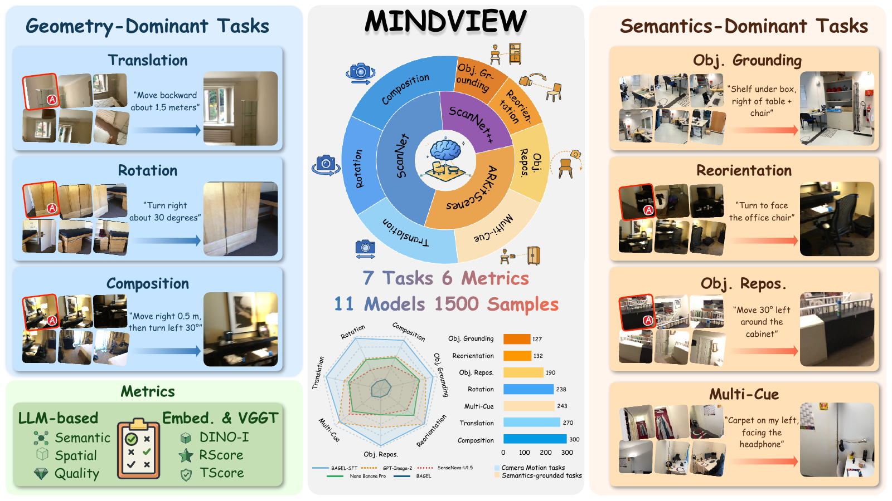

# MindView

**Benchmarking Generative Multi-View Spatial Intelligence**

[Benchmark](https://huggingface.co/datasets/wangyanbo/MindView-Bench) · [Training data](https://huggingface.co/datasets/wangyanbo/MindView-Train) · [BAGEL-SFT](https://huggingface.co/wangyanbo/MindView-BAGEL-SFT)

## Release checklist

- [x] MindView-Bench benchmark data and fixed evaluation metadata
- [x] MindView-Train data and reproducible BAGEL-SFT recipe
- [x] Published BAGEL-SFT checkpoint and inference pipeline
- [x] Six-component image metrics and validated report builder
- [x] SAT-v2, MMSI-Bench, and MindCube-Tiny evaluation
- [x] Single-GPU end-to-end verification script
- [ ] Training-Free strategy (MindCue) — not open-sourced yet



## 1. Overview

MindView evaluates language-guided target-view generation from multiple RGB images
of the same indoor scene. It contains **1,500 cases from 513 scenes** across
ScanNet, ScanNet++, and ARKitScenes. The standard input is **six context images
and a spatial query**. Nested C3/C6/C10 settings produce 4,500 experiment records
on these same cases. Targets, depth, and numerical camera parameters are withheld
from the generator.

Seven tasks cover translation, rotation, composition, relational object grounding,
target-facing reorientation, object-centric repositioning, and multi-cue viewpoint
inference. This release provides evaluation, BAGEL supervised fine-tuning, and
spatial-understanding transfer evaluation.

| Directory | Guide |
|---|---|
| `evaluation/` | [Generate images, import your predictions, compute metrics](evaluation/README.md) |
| `sft/` | [Reproduce the frozen BAGEL-SFT training recipe](sft/README.md) |
| `understanding/` | [SAT-v2, MMSI-Bench, and MindCube-Tiny](understanding/README.md) |
| `vggt/` | [Shared geometric model runtime](vggt/README.md) |

## 2. Evaluate MindView

### Download resources

Use the same immutable snapshot for metadata and image archives. From the
repository root, install the Hugging Face CLI in a download environment, then:

```bash
python -m pip install -U huggingface_hub
hf download wangyanbo/MindView-Bench --repo-type dataset \
  --revision f89c6d8342cb0ed5ff098115967e23813ec250ce \
  --local-dir resources/MindView-Bench
python resources/MindView-Bench/scripts/prepare_data.py \
  --repo resources/MindView-Bench --output resources/data
```

Extraction verifies file and TAR-member hashes before restoring
`resources/data/{scannet,scannetpp,arkitscenes}/`. The package includes **14,276
RGB images and 14,276 depth maps**, covering generation inputs, targets, and fixed
ten-view scoring references. Use `--verify-only` instead of `--output` for a
check without extraction. Images and millimetre-depth values are preserved.

[Train download and preparation](sft/README.md) uses snapshot
`c838213f3358013345b5352fdef71a76dfb0d222`: 20,000 records and 104,716 RGB images.
It can be extracted into the same `resources/data/` directory. Train and benchmark
scene identities are disjoint. Model weights and understanding datasets have
separate download instructions in their workflow guides.

The public evaluation chain uses two Conda environments: `mindview_bagel` for
BAGEL generation and understanding, and `mindview_metrics` for CLIP/DINO, Qwen-VL,
and VGGT. Install the requirements from the workflow guides, download the pinned
datasets and model snapshots, then fill in the interpreter and asset paths in
`config.env.example`. The local bootstrap helper is intentionally kept out of
the public release.

### Configure and run

Use Linux/Bash with the two prepared interpreters. BAGEL uses
`mindview_bagel`; CLIP/DINO, Qwen-VL, and VGGT use `mindview_metrics`.
Copy the shared template and fill the extracted dataset roots, interpreter paths,
model assets, and checkpoint paths:

```bash
cp config.env.example config.env
export CONFIG_FILE="$PWD/config.env"
bash evaluation/run.sh check
```

`config.env` is ignored by Git and loaded only when explicitly selected.
Its assignments override exported values; unset `CONFIG_FILE` for export-only
configuration. The [model resources](evaluation/benchmark_runner/README.md#obtain-generation-resources)
and [metric checkpoints](evaluation/benchmarker_metrics/README.md#obtain-metric-checkpoints)
guides give official sources and fixed revisions.

To evaluate the **official 1,500 C6 cases**, put these settings into `config.env`
with your model and dataset paths:

```bash
INPUT_JSON="$PWD/resources/MindView-Bench/data/test.jsonl"
VGGT_CANONICAL_JSON="$PWD/evaluation/data/merged_dataset_final.jsonl"
REPORT_PROTOCOL=selected
GENERATION_ROOT="$PWD/outputs/official_c6/generations"
METRICS_ROOT="$PWD/outputs/official_c6/metrics"
REPORT_ROOT="$PWD/outputs/official_c6/reports"
```

```bash
# BAGEL-SFT generation, metrics, and report.
bash evaluation/run.sh all bagel-sft-final
```

For the full context-scaling experiment, use the bundled
`evaluation/data/merged_dataset_final.jsonl`, `REPORT_PROTOCOL=paper`, and separate
output directories. This index has SHA256
`97be55cb44c45d693acd370175805804c12f95b99bebb115f0df1e1b2077219b`.

### Evaluate your own model

Generate one **512 × 512 RGB PNG named `<sample_id>.png`** for each chosen frozen
record, preserving its context order and instruction. Keep the target out of
model inputs. Import that folder with `evaluation/import_predictions.py`, then
run the normal metrics and report stages. The [format and import example](evaluation/README.md#evaluate-images-generated-outside-this-repository)
explains the metadata contract, source GT/context resolution, and custom method IDs.

The six primary scores are **DINO-I, Semantic, Spatial, Quality, VGGT-RScore,
and VGGT-TScore**. Average examples within tasks, then equally average the seven
task means; **Overall / Avg6** averages the six scores. CLIP-I is auxiliary.
The frozen Qwen judge sees target/prediction for Semantic/Spatial and prediction
alone for Quality. VGGT always uses the same ten source references plus GT and
prediction; sensor depth calibrates translation to metres.

## 3. BAGEL-SFT: reproduce training

Download the [frozen Train snapshot and pinned BAGEL assets](sft/README.md), then
configure `TRAINING_JSONL`, the three RGB roots, and `BAGEL_MODEL_PATH`.
The release recipe uses **20,000 shot-6 records, eight GPUs, 10,000 updates,
AdamW, learning rate 1e-5 → 1e-6, 200 warmup steps, and EMA 0.9995**.

```bash
bash sft/run.sh --dry-run --check-images
bash sft/run.sh
```

The [complete recipe table](sft/README.md) fixes transforms, optimizer, losses,
packing/token budgets, seeds, accumulation, and frozen/trainable components.
The launcher validates the data checksum and scene separation before training;
use its release defaults to reproduce the recipe. The final full training
checkpoint is `checkpoints/0009999/`; the published BF16 EMA is an inference
export and does not contain optimizer/scheduler state for exact continuation.
Point `BAGEL_SFT_FINAL_CHECKPOINT` at the published or locally trained
`ema.safetensors` for all generation and understanding evaluations.

## 4. Three spatial-understanding benchmarks

Prepare the [pinned official datasets and environment](understanding/README.md),
then run BAGEL-SFT with the same base assets and EMA checkpoint:

```bash
bash understanding/run.sh all --dry-run
bash understanding/run.sh all --prepare-only
bash understanding/run.sh all
```

The sequence is **SAT-v2: 150 questions in both option orders / 300 inferences;
MMSI-Bench Vanilla: 1,000; MindCube-Tiny raw QA: 1,050**. Greedy decoding,
no thinking, BF16, original image transforms, and the official scoring protocols
are retained. Individual benchmark commands and result files are documented in
[understanding](understanding/README.md). Explicit diagnostic limits are marked
partial and kept separate from full results.

## 5. Sequential single-GPU test

After preparing all model assets, RGB/depth data, and the three QA datasets:

```bash
bash test_single_gpu.sh --config "$PWD/config.env" --gpu 0 --dry-run
bash test_single_gpu.sh --config "$PWD/config.env" --gpu 0
```

The [single script](test_single_gpu.sh) selects ten random standard C6 cases
(seed 42), generates with BAGEL-SFT, computes all six scores, writes the subset
report, then evaluates the three **full** understanding benchmarks sequentially.
Every stage uses one visible GPU and exits before the next stage if it fails.
Outputs/logs default to `outputs/single_gpu_test/`; identical inputs can resume.
Use a new `--output-root` when changing the seed or checkpoint. The ten-case
report covers only sampled tasks and is **not a full MindView benchmark score**.
`--understanding-limit N` is an explicit partial diagnostic; omit it for performance
measurement. The frozen 30B VLM judge makes an 80GB-class GPU a practical choice.

## 6. Validation and licenses

Each workflow includes CPU tests. Configuration/dry runs and small fixture tests
do not replace actual GPU generation or training validation.
Run workflow tests separately to isolate their model-runtime imports:

```bash
(cd evaluation && python -m pytest)
(cd sft && python -m pytest)
python -m unittest discover -s understanding/tests
python -m unittest discover -s tests
```

This repository retains the root [MIT license](LICENSE), bundled
[BAGEL license](sft/LICENSE), [VGGT license](vggt/LICENSE.txt), and
[DreamOmni2 notice](evaluation/third_party/dreamomni2/NOTICE.md).
Datasets and externally downloaded models retain their own terms.
